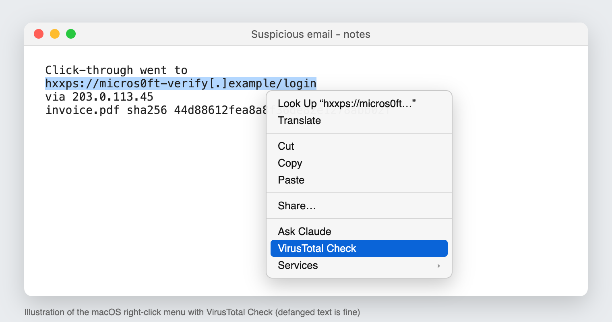
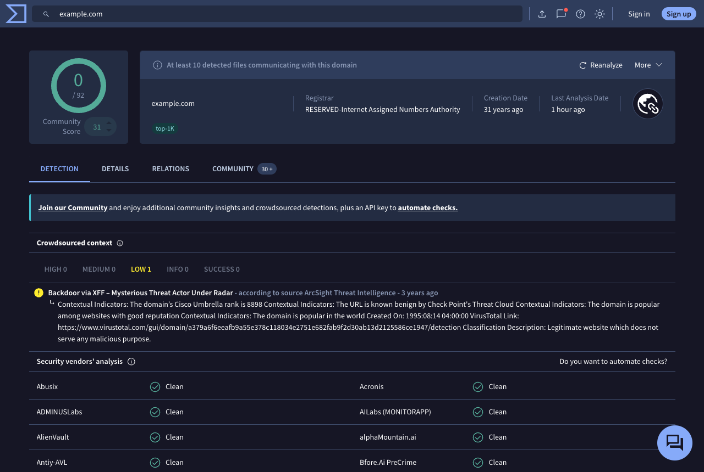

# VirusTotal Check (macOS)

Highlight a link, domain, IP or file hash **anywhere on your Mac**, right-click, choose **VirusTotal Check**,
and Chrome opens its VirusTotal report.





## Why
Analysts copy indicators out of emails, tickets, chat and reports all day. VirusTotal's browser extension only
works inside the browser; this works in every app (Mail, Slack, Terminal, PDFs, notes) and understands
**defanged** text, so `hxxps://evil[.]com` from a threat report just works.

## Install
```sh
git clone https://github.com/pkure/VT-QuickCheck.git ~/vt-check
/usr/bin/python3 ~/vt-check/install.py
```
Then quit and reopen any app that was already open. In some apps the item is under **Services**.
Optional shortcut: System Settings > Keyboard > Keyboard Shortcuts > Services > Text > VirusTotal Check.

No dependencies (macOS's built-in Python 3), no API key, no background process.

## What it does
| You highlight | It opens |
|---|---|
| `https://…` / `hxxps://…[.]…` | VirusTotal search for that URL (looks up an existing report) |
| `evil.example` / `user@evil.example` | the domain's report (never the email's user part) |
| `8.8.8.8` | the IP address report |
| MD5 / SHA-1 / SHA-256 | the file report |

Several indicators at once open up to 5 tabs. Nothing recognizable means a notification, and nothing is sent.

## Privacy and safety
- **Look-ups only.** Nothing is uploaded or submitted for scanning; it opens VirusTotal's own pages.
- VirusTotal sees what you look up, so links that carry an **email address or a personal token** are reduced to
  their domain (with a notification). Private/internal IPs and file names like `invoice.pdf` are skipped.
- It never visits the suspicious link itself: Chrome only loads virustotal.com.

## How it works
`install.py` writes a standard macOS Quick Action (`~/Library/Services/VirusTotal Check.workflow`) that pipes
the selected text to `vtcheck.py`. That script refangs the text, extracts indicators, and runs
`open -a "Google Chrome" <VirusTotal links>` (falling back to your default browser).

**Uninstall:** delete `~/Library/Services/VirusTotal Check.workflow`.
**Tests:** `/usr/bin/python3 -m unittest discover -s tests`
